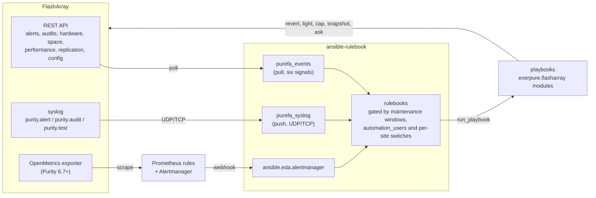

# flasharray-eda

Event-Driven Ansible for standalone Everpure FlashArrays.

A FlashArray already exposes the three things an event-driven loop needs:
a cursorable alert log, an attributable audit log, and its own performance
and capacity history. This project turns those into `ansible-rulebook`
events and acts on them through the `everpure.flasharray` collection. No
Pure1, no Fusion and no external monitoring stack are required; a
Prometheus/Alertmanager path exists for sites that already run one.

Status: a prototype, not a supported product. The REST-pull rulebooks (the
first eight rows of the table below) are verified against two Purity//FA
6.10.6 arrays; the syslog listener receives both arrays' live syslog as a
platform activation and its audit rule launches job templates; the
Prometheus rules evaluate on a live Prometheus scraping both arrays'
native exporters and the capacity and replica-link rules drive the
Alertmanager path end to end into the platform's activation (a posted
hardware alert also lights the identify LED); the
Ansible Automation Platform seed, the controller-tier approval workflow
and the capacity, day-2 and DR orchestrator workflows are verified against
a 2.7 installation and a live orchestrator; the rulebooks run as activations
on the platform from the decision-environment image and launch job
templates. [docs/VERIFICATION.md](docs/VERIFICATION.md) lists what is
exercised on hardware, [docs/DESIGN.md](docs/DESIGN.md) the design and
scope, and [docs/HARDWARE_NOTES.md](docs/HARDWARE_NOTES.md) the array and
rulebook behaviour the rules are written around.

Three transports feed the same rulebooks and the same playbooks:



## Quick start

Requirements: Python 3.9+ and Java 17+ (for ansible-rulebook);
ansible-rulebook 1.3.x and ansible-core 2.17 (the tested versions;
`requirements.txt` holds the minimums); `everpure.flasharray` >= 1.46.0 and
`ansible.eda` >= 2.13.0 (`requirements.yml`); py-pure-client >= 1.94.1.
Tested against Purity//FA 6.10.6 (REST 2.46).

```
python3 -m venv venv && . venv/bin/activate
make deps                                   # pip install -r requirements.txt; ansible-galaxy collection install -r requirements.yml; make collection
cp env.example ~/.flasharray-eda.env        # URLs and tokens for both arrays, APPROVAL_TOKEN, GIT_WEBHOOK_SECRET; chmod 600
cp vars/example.yml vars/local-lab.yml      # edit: arrays, absolute paths (alert_log, request_dir, baseline_dir), baselines, thresholds, switches
cp inventory/example.yml inventory/local-lab.yml
./run.sh extensions/eda/rulebooks/alerts.yml -v
```

The repository is the collection `sdodsley.flasharray_eda` (`galaxy.yml` at
the root): the rulebooks name their event sources by FQCN,
`sdodsley.flasharray_eda.purefa_events` and
`sdodsley.flasharray_eda.purefa_syslog`, and ansible-rulebook resolves them
from an installed collection. `make collection` (which `make deps` runs
last) builds the tarball into `build/` and installs it under
`./collections`; [docs/PACKAGING.md](docs/PACKAGING.md) has the details.

`run.sh` sources `env.sh`, which loads `~/.flasharray-eda.env` (override
with `FAEDA_ENV`), activates `./venv` (`FAEDA_VENV`) or else expects
`ansible-rulebook` on the PATH and says so, puts `./collections` (when that
directory exists) and `~/.ansible/collections` on
`ANSIBLE_COLLECTIONS_PATH`, which is where the FQCN sources resolve from,
and defaults `FAEDA_VARS` to `vars/local-lab.yml` and `FAEDA_INVENTORY` to
`inventory/local-lab.yml`. It then starts the rulebook (still passing
`--source-dir extensions/eda/plugins/event_source`, which ansible-rulebook
consults for bare names only and which is harmless for a FQCN) and hands
`APPROVAL_TOKEN` and `GIT_WEBHOOK_SECRET` to ansible-rulebook with
`--env-vars` when they are set in the environment; that is how the webhook
rulesets read them (`{{ APPROVAL_TOKEN }}` in a rulebook is an environment
variable, not a vars-file key).

Three things to get right on the first run:

- **Arrays.** The example vars and inventory name two arrays. Either fill in
  both the `ARRAY_A_*` and `ARRAY_B_*` pairs in the env file, or remove
  `array-b` from `purefa_arrays`, from the inventory and from the
  `dr_drills` entry. The source plugin refuses to start when a listed
  array's environment variables are empty.
- **Paths.** `alert_log` and `request_dir` default under `/var`, which needs
  root or a directory created and chowned beforehand; for a local run point
  them at a directory the rulebook user can write. `baseline_dir` is a
  separate checkout of the baseline repository
  ([baseline/README.md](baseline/README.md)), not this tree. The `/var` and
  `/opt` defaults are the decision-environment image layout.
- **Credentials.** Tokens and URLs reach the plugin through
  `api_token_env` / `fa_url_env` and the playbooks through the inventory's
  `lookup('env', ...)`, so no vars file holds a secret. Give the polling
  token a read-only array role; the plugin only issues GETs. The remediation
  playbooks use the inventory credential, which should be a dedicated
  service account named in `automation_users`.

## What it does

| Rulebook | Source | Fires on | Action |
| --- | --- | --- | --- |
| `alerts.yml` | alerts | alert opened / closed | routes through the alert-code runbook map: notify, ticket, or per-code tasks, with the array's own action text and KB link |
| `change_control.yml` | audits, webhook | a governed setting changed by anyone but the automation account; a destructive command by a human; a signed git push | reconcile from the git baseline (NTP, DNS) and report who; notify; apply the baseline forward |
| `config_drift.yml` | config | NTP, DNS, LDAP, SafeMode/eradication, admin auth settings vs baseline (poll-based fallback) | NTP and DNS reapplied; the rest notify |
| `health.yml` | health | hardware component not ok; drive not healthy; controller failover; maintenance window; remote assist | hardware component not ok: identify LED + notify, logged only inside a maintenance window; drive not healthy, controller failover: notify; maintenance window, remote assist: logged |
| `replication.yml` | replication, tick | connection down or paths failed; replica link paused, unhealthy, lag over RPO (escalates after N polls); stretched pod member offline / recovered; protection group overdue or stuck; a schedule | notify; move host preferred arrays to the online side and back; replicate now; DR drill (copy a volume from the latest replicated snapshot on the target, verify, destroy) |
| `capacity.yml` | telemetry, webhook | used % over threshold; days-to-full from the array's 7-day history; an approval (bearer token) | approval request with request id; reclaim pending-eradication objects only when approved |
| `performance.yml` | telemetry | noisy neighbour on a hot array; capped volume back to normal; array write latency vs the same half hour last week | temporary IOPS cap with an `eda/qos_cap` tag on the array; cap lifted; notify |
| `anomaly.yml` | telemetry + audits | data reduction drop + snapshot or write surge + a human destroying snapshots, all on one array inside 15 minutes | snapshot every local protection group now, lengthen the eradication delay, page |
| `syslog.yml` | purefa_syslog | `purity.audit` / `purity.alert` / `purity.test` lines pushed by the array | fast notification seconds after the fact |
| `alertmanager.yml` | ansible.eda.alertmanager | alerts from `prometheus/flasharray.rules.yml` on the native OpenMetrics exporter | the same playbooks, no custom code on the array side |

Every remediation is gated: `maintenance_active` on the event (one cached
`/maintenance-windows` read per array), an `automation_users` list so the
automation never reacts to itself, and per-site switches
(`qos_auto_cap`, `activecluster_auto_prefer`, `replication_auto_replicate_now`)
that fall back to notify. Every record a playbook writes to the alert log
carries `time`, `kind`, `severity` and `array`.

## Layout

```
galaxy.yml, meta/runtime.yml           the repository root is the collection sdodsley.flasharray_eda (docs/PACKAGING.md)
extensions/eda/plugins/event_source/   purefa_events.py (REST pull, six signals), purefa_syslog.py (push)
extensions/eda/rulebooks/              one rulebook per domain (table above), sources named by FQCN
playbooks/                             notify, remediate_*, reconcile, apply_baseline, identify_led, replicate_now, dr_promote, dr_demote,
                                       preferred_array, dr_drill, capacity_request/reclaim, qos_cap, protect_now,
                                       expand_volume, orchestrator_post,
                                       alert_runbook (+ runbooks/<code>.yml, included relative to the playbook)
orchestrator/                          workflow definitions for the automation orchestrator and job_templates.txt
                                       (orchestrator/README.md)
tools/ao_lint.py                       offline linter for those definitions (`make lint-ao`)
tools/ao_sync.py                       imports the definitions into an orchestrator (orchestrator/README.md, "Importing")
slack/approval_bot.py                  Slack Socket Mode bot: approval cards with Approve/Reject buttons for the orchestrator
                                       and the controller (slack/README.md)
aap/                                   seed.yml, vars, inventory and credential types that build the AAP 2.7 objects;
                                       execution and decision environment definitions (aap/README.md)
baseline/                              schema of the git baseline (README); the real files live in a separate checkout
prometheus/                            flasharray.rules.yml (alert rules for the native exporter, for the Prometheus
                                       server), prometheus.example.yml and alertmanager.example.yml (scrape and routing)
decision-environment/                  Containerfile and ansible-builder definition on ansible-rulebook v1.3.2; both build and
                                       install the collection (see below)
vars/example.yml, inventory/example.yml  copy to vars/local-<site>.yml and inventory/local-<site>.yml (gitignored)
env.example, env.sh, run.sh            env file template, shared environment setup, launcher
tests/                                 unit/ (no array needed), mock_orchestrator.py, lab induction playbooks, fixtures,
                                       replay rulebooks, e2e_*.sh (everything they write goes under tests/out/)
docs/                                  DESIGN.md (design and scope), VERIFICATION.md (what is exercised on hardware),
                                       HARDWARE_NOTES.md (array and rulebook behaviour), ORCHESTRATOR.md (the handoff
                                       contract), PACKAGING.md (the collection, its build and the decision environment)
Makefile                               `make check` runs what CI runs; `make collection` builds and installs the
                                       collection; `make de` builds the image
requirements.txt, requirements.yml     Python packages and the two collections (everpure.flasharray >= 1.46.0)
```

## The source plugins

`purefa_events` polls one or more arrays with py-pure-client and emits plain
fact events; policy lives in the rulebooks. `arrays` is a list, or a JSON
string that decodes to one so a platform credential can inject it as a
single variable. One instance can run several signals, each on its own
interval; every REST call is bounded by `request_timeout` (default 30 s):

| Signal | Endpoints | Events |
| --- | --- | --- |
| alerts | `/alerts` (state != closed), diffed locally | `purefa_alert` with transition initial / opened / updated / closing / closed |
| audits | `/audits` newest N, cut at a local time cursor | `purefa_audit` with user, command, subcommand, arguments, by_automation |
| health | `/hardware`, `/drives`, `/controllers`, `/maintenance-windows`, `/support` | `purefa_health`, `purefa_hardware` per issue, `purefa_controller_failover` |
| telemetry | `/arrays/space` (+ 7-day history), `/volumes/space` (growth tracked across the `growth_volumes`, default 500, largest live volumes), `/arrays/performance` (+ same half hour last week), `/volumes/performance` top N (plus any volume tagged `eda/qos_cap`, whatever its rank), volume QoS and tags | `purefa_capacity` (days_to_full, top growers, pending eradication, drr_drop, snapshot_surge), `purefa_array_performance` (baseline ratios, write_surge), `purefa_volume_performance` (streak counters, iops share, QoS limit, eda_capped) |
| replication | `/array-connections` (+ paths), `/pod-replica-links`, `/pods` (stretched), `/protection-groups` (+ targets, transfers) | `purefa_array_connection` (failed paths), `purefa_replica_link` (rpo_breached, breach streak, paused_for_s), `purefa_stretched_pod` (online/offline arrays, recovered), `purefa_pg_replication` (overdue, stuck) |
| config | `/arrays`, `/dns`, `/directory-services`, `/admins/settings`, `/syslog-servers`, `/smtp-servers`, `/alert-watchers`, `/support` | `purefa_config` |

Every event carries `array`; alert, audit, hardware and replication events
also carry `maintenance_active`; poll failures arrive as `purefa_poll_error`
and polling continues. Full argument and field lists are in the plugin
docstrings.

`purefa_syslog` listens on UDP and TCP for the array's syslog and emits
`purefa_syslog` with the audit fields parsed: Purity writes a command record
(`[user (local)]@array(id) purevol destroy v1. Message ID: N ...`) for
every CLI, GUI and REST command and a `Key: 'value'` record for sessions,
and both become `user`, `action`, `command`, `result` and the rest. An
array forwards its controllers' whole system log to a syslog target, so
the listener keeps the `purity.alert`, `purity.audit` and `purity.test`
programs and drops everything else (`programs`; `all` passes it through as
kind `other`). The array's own service accounts count as automation
(`system_users`). `allowed_sources` restricts the senders it accepts (empty =
any) and `arrays` maps an array's own name or its syslog hostname to the
inventory name (the message's "Array name" field is tried first, then the
syslog hostname, which is the controller's).

The zero-code path needs neither plugin: Prometheus scrapes the array's
native OpenMetrics exporter, `prometheus/flasharray.rules.yml` raises alerts
carrying a `domain` label, Alertmanager posts them to
`ansible.eda.alertmanager`, and `alertmanager.yml` runs the same playbooks.
The rules follow the names and labels the native exporter serves on
Purity//FA 6.10.6 (listed at the top of the rules file) and evaluate on a
live Prometheus; `prometheus/prometheus.example.yml` and
`alertmanager.example.yml` are the scrape and routing configurations.

## Listeners

Four rulesets listen on the network. Each is bound and authenticated
differently (see also [SECURITY.md](SECURITY.md)):

- **Capacity approvals** (`approval_port`, default 5001): the POST must
  carry `Authorization: Bearer $APPROVAL_TOKEN`.

      curl -s -X POST http://<eda host>:5001/endpoint \
        -H "Authorization: Bearer $APPROVAL_TOKEN" -H 'Content-Type: application/json' \
        -d '{"request_id": "<id>", "approve": true, "approver": "jane", "action": "eradicate_pending"}'

- **Git push** (`webhook_port`, default 5000): the POST must carry GitHub's
  `X-Hub-Signature-256: sha256=<hex HMAC-SHA256 of the exact body>` made
  with `GIT_WEBHOOK_SECRET`; GitHub adds it when the webhook has a secret.
  By hand:

      BODY='{"ref":"refs/heads/main","after":"<sha>"}'
      SIG=$(printf '%s' "$BODY" | openssl dgst -sha256 -hmac "$GIT_WEBHOOK_SECRET" | awk '{print $NF}')
      curl -s -X POST http://<eda host>:5000/endpoint \
        -H "X-Hub-Signature-256: sha256=$SIG" -H 'Content-Type: application/json' -d "$BODY"

- **Alertmanager** (`alertmanager_host`, `alertmanager_port`, default
  5002): `ansible.eda.alertmanager` has no token option. Bind it to an
  interface only Alertmanager can reach and put it behind the EDA
  controller's event streams or a reverse proxy that authenticates.
- **Syslog** (`syslog_host`, `syslog_port`, default 5140; on the array,
  a syslog server with the URI `tcp://<eda host>:5140`):
  `syslog_allowed_sources` lists the addresses or CIDR prefixes the listener
  accepts (empty = any). It is a filter, not authentication; UDP source
  addresses can be forged, which is one reason `syslog.yml` only notifies.
  `syslog_programs` keeps the Purity programs and drops the controllers'
  other system log, which the array forwards too.

## Notifications

Every rule that notifies runs `playbooks/notify.yml`, which appends a
record to the alert log and, when `SLACK_WEBHOOK_URL` is set (env file;
on the platform the `Slack webhook` credential on the notify template),
posts the same record to a Slack incoming webhook: an icon for the
severity, the subject, the array and the detail. A failed post is
reported in the job and never fails the notification; the alert log is
the record, Slack is the pager. On the platform `aap/seed.yml` also
creates a Slack notification template (bot token, `chat:write`) that posts
job failures and the controller-tier workflow's approval events, each
with its link into the platform ([aap/README.md](aap/README.md)).
Deciding from the channel is `slack/approval_bot.py`: a Socket Mode bot
that posts every pending orchestrator and controller approval as a card
with Approve and Reject buttons and carries the click back with the Slack
user's name ([slack/README.md](slack/README.md)).

## Decision environment and Ansible Automation Platform

`decision-environment/` holds a Containerfile and an ansible-builder
definition, both on `quay.io/ansible/ansible-rulebook:v1.3.2`, that produce
the same tree: the collection `sdodsley.flasharray_eda`, built from the
checkout at image build time and installed with `everpure.flasharray` and
`ansible.eda`, py-pure-client, and the rulebooks and playbooks as plain
files under `/opt/flasharray-eda` for runs that name them by path
([docs/PACKAGING.md](docs/PACKAGING.md)). CI does not build the image. The
image is self-contained for standalone `ansible-rulebook` runs, with no
`--source-dir`: the Containerfile header has the `podman run` line, which
mounts `vars/`, `inventory/` and the baseline checkout and passes the
credentials as environment variables. `ANSIBLE_COLLECTIONS_PATH` in the
image names `/usr/share/ansible/collections` and the base image's
`/app/.ansible/collections`, where `ansible.eda` lives.

EDA Controller activations pass no `--source-dir` and resolve custom event
sources only from the collections installed in the decision environment;
the rulebooks name theirs by FQCN, so an activation on this image resolves
`purefa_events` and `purefa_syslog` from the collection it carries.
On the platform the rulebooks run as the generated variants under
`extensions/eda/rulebooks/platform/` (`tools/platform_rulebooks.py`): the
same rules, with `run_playbook` replaced by `run_job_template` against the
seeded job templates and the webhook rulesets left out, because approvals
and git pushes arrive through the controller workflow and event streams
there. `aap/seed.yml` creates the organization, the credential types
(`FlashArray API`, one credential per array; `FlashArray fleet`, whose
single credential carries every array; `Orchestrator service account`),
the credentials, inventory, project, job templates, the controller-tier
approval workflow and one rulebook activation per platform rulebook
([aap/README.md](aap/README.md)). The seed, the job templates and
the controller-tier approval workflow (request, human approval, reclaim)
and the activations (running, polling both arrays and launching job
templates through `run_job_template`) are verified against an Ansible
Automation Platform 2.7 installation.

### Orchestrator handoff

With `orchestrator_enabled: true` in the vars file, the capacity-at-risk
rule (and the overdue-replication rule, whose approval gates an immediate
replicated snapshot) hands its event to Red Hat's automation orchestrator instead of
writing a local request: `playbooks/orchestrator_post.yml` obtains a
client-credentials token (`AO_CLIENT_ID` / `AO_CLIENT_SECRET` from the
environment, forwarded by `run.sh`) and posts a `flasharray-eda/1`
envelope to the workflow's EDA trigger; the approval and the reclaim then
run in the orchestrator. Every attempt is recorded in the alert log and a
refusal never fails the rule. [docs/ORCHESTRATOR.md](docs/ORCHESTRATOR.md)
has the contract, the vars and the mock (`tests/mock_orchestrator.py`)
the unit test and `tests/replay_capacity.yml` run against. The handoff is
verified against a live orchestrator (the upstream code of the 2026.8
release): the post, the approval and the reclaim run through.

## Array and rulebook behaviour

Facts the rules are written around;
[docs/HARDWARE_NOTES.md](docs/HARDWARE_NOTES.md) has the longer list.

- `/audits` rejects a filter on `time`; `/alerts/events` needs REST 2.50;
  history resolutions are fixed (30 s, 5 min, 30 min, 2 h, 8 h, 1 day);
  maintenance windows take 3600 to 172800 seconds; the alert watcher test
  needs watcher names.
- Purity logs NTP changes as `purearray setattr --ntpserver`, not `purentp`.
- ansible-rulebook: no filters or arithmetic in conditions (the plugin emits
  the booleans; actions may use filters); `once_within` must be a literal
  and is rejected on a multi-event condition (`anomaly.yml` carries no
  throttle; its 15 minute `timeout` bounds re-firing); `run_playbook` copies
  the playbook's whole directory into a temporary project, so relative
  includes under `playbooks/` work and files outside it do not; `--vars`
  takes one untemplated file; `localhost` must be in the inventory.
- State that must survive a rulebook restart lives on the array: the QoS
  cap is a volume tag in namespace `eda`, the approval request is a file.

## Testing

`make check` needs no array: black, pyflakes and yamllint; `make lint-ao`
(the orchestrator definitions through `tools/ao_lint.py`); the unit tests
(`python -m pytest tests/unit`: a fake SDK client drives the alert diff and
the audit cursor, the syslog parser gets representative lines, static
checks validate every rulebook against ansible-rulebook's own schema,
require every lowercase variable a rulebook references to be documented in
`vars/example.yml` and every playbook a rule runs to exist, plus the
orchestrator bridge against its mock, the linter and its fixtures, and the
job artifacts every playbook publishes); and a playbook syntax check.
`tests/unit/test_orchestrator_bridge.py` runs `orchestrator_post.yml`
against the mock (skipped without `ansible-playbook`), `test_ao_lint.py`
covers every linter rule with a fixture, `test_playbook_artifacts.py`
checks the `set_stats` artifacts, the credential guard and the seed. GitHub
Actions runs the same on every push.

`tests/replay_*.yml` are copies of the live rules driven by
`ansible.eda.generic` from the fixtures under `tests/fixtures/`
(ansible-rulebook has no include). They must stay rule-for-rule identical
to the real rulebooks, throttles included; the unit test fails when they
drift.

`tests/e2e_sources.sh`, `tests/e2e_change_control.sh`,
`tests/e2e_replication.sh` and `tests/e2e_approvals.sh` run the rulebooks
against live arrays, inducing what can be induced (NTP drift, a second
user's changes, a paused replica link, a maintenance window, a
pending-eradication volume, a busy volume capped and uncapped) and
replaying fixtures for what cannot (hardware failures, a degraded stretched
pod, the anomaly signals); the replayed events still drive the real actions
on the array. They source `env.sh`; read the array credentials from the
environment variables named by `A_URL_ENV` / `A_TOKEN_ENV` (default
`ARRAY_A_URL` / `ARRAY_A_TOKEN`); take array and object names from
environment variables with no defaults (each script prints a usage line
when one is missing); derive their own vars file into
`tests/out/vars_test.yml` from `FAEDA_VARS` with `alert_log` and
`request_dir` rewritten under `tests/out/`; and never delete anything
outside `tests/out/`. `tests/e2e_approvals.sh` refuses its eradicate step
when the array already holds pending-eradication objects, unless
`E2E_ERADICATE_ALL=1` is set. [docs/VERIFICATION.md](docs/VERIFICATION.md)
lists what each script exercises on hardware and what is replayed only.

`tests/syslog_send.py` sends representative lines to the syslog listener.
The Alertmanager path is exercised by POSTing a webhook payload to
`alertmanager.yml`, for example:

    curl -s -X POST http://127.0.0.1:5002/alerts -H 'Content-Type: application/json' -d '{
      "status": "firing", "alerts": [{"status": "firing",
        "labels": {"alertname": "FlashArrayHardwareComponentNotOk", "array_name": "array-a",
                   "component_name": "CT1", "component_type": "controller",
                   "severity": "critical", "domain": "health"},
        "annotations": {"summary": "CT1 is critical"}}]}'

## Related

- Blog post: "Your FlashArray is already an event source"
  (https://theansibleguy.com/your-flasharray-is-already-an-event-source/),
  the ideas behind this project.
- Predecessor: the "Fusion MCP + Ansible thought experiment"
  (https://github.com/sdodsley/fusion-ansible-mcp).
- Collection: https://github.com/Everpure-Ansible/FlashArray-Collection
  (module bugs go there, not here)
- Rulebook docs: https://docs.ansible.com/projects/rulebook/en/latest/

## Licence

Apache 2.0, see [LICENSE](LICENSE).
